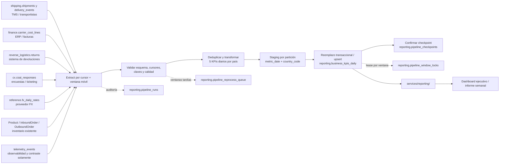

# Pipeline de Desempeño de Negocio de TrackFlow

> **Estado:** diseño propuesto para la Parte 1 de 3. Los nombres de las métricas, tablas analíticas e interfaces de fuentes que se identifican como propuestos son un contrato de diseño para validar con negocio; no existen todavía en el repositorio ni se presentan como datos ya disponibles.

## 1. Estado actual y brecha de negocio

La telemetría actual registra actividad técnica y algunas operaciones de inventario. El catálogo [event-schemas.json](../../docs/telemetry/event-schemas.json) define el envelope `eventId`, `timestamp`, `sessionId`, `userId`, `event_type`, `schemaVersion`, `requestId` y `properties`. El backend persiste los eventos aceptados en `telemetry_events`: `id`, `timestamp`, `service`, `event_type`, `level`, `value`, `message` y `tags`. `eventId` es la clave de deduplicación; las propiedades y el contexto adicional se guardan en `tags`.

El endpoint técnico `GET /telemetry/report` agrega volumen de eventos por día/tipo, tasa **observada** de errores por código y latencia media por ruta. No es una fuente de verdad para resultados logísticos ni sustituye los sistemas operativos. En particular, `api_latency_recorded` es muestreado y la tasa de errores no equivale a una tasa total de fallos.

El backend del repositorio contiene las entidades SQLModel `Product`, `InboundOrder` y `OutboundOrder`. Los eventos `inbound_order_created` y `outbound_order_created` identifican una orden, producto/SKU, almacén y cantidad. Una salida de inventario no demuestra por sí sola que se haya creado un envío, que el transportista lo haya entregado o que la entrega fuese puntual. Tampoco hay en los modelos inspeccionados hechos de coste, devoluciones ni respuestas de satisfacción.

Por tanto, el reporte técnico sirve a ingeniería para entender el comportamiento de la aplicación, pero no responde a Daniel Espinoza ni a dirección ejecutiva si aumentan los envíos, se cumplen las fechas prometidas, cuánto cuestan las operaciones, qué devoluciones se tramitan o cómo valoran el servicio los clientes. El dashboard global y el informe semanal siguen requiriendo consolidación manual. El nuevo pipeline cubre esa brecha con datos operativos autoritativos; no altera el informe de telemetría.

## 2. Propósito

Producir para el dashboard ejecutivo de TrackFlow el volumen de envíos, la tasa de entregas a tiempo, el coste operativo atribuible a envíos, el volumen de devoluciones y la satisfacción del cliente, con desglose por país y una base trazable para el informe semanal de dirección.

### Definiciones de negocio propuestas

Las siguientes definiciones concretan los conceptos de `CONTEXT.md`, que no proporciona fórmulas ni un contrato de medición. Se proponen para este diseño y deben aprobarse por dirección/operaciones antes de implementación; no son KPIs ya configurados en el monorepo.

| Código estable | Definición y fórmula diaria | Unidad y notas |
| --- | --- | --- |
| `shipment_volume` | Conteo de `shipment_id` distintos cuya expedición fue aceptada/creada durante el día. | Envíos; no contar `OutboundOrder` como envío. |
| `on_time_delivery_rate` | `100 × entregas con delivered_at <= promised_delivery_at / entregas completadas con delivered_at y promised_delivery_at válidos`. | Porcentaje; el denominador excluye entregas sin promesa o sin entrega final y se expone como conteo. |
| `operating_cost_eur` | Suma de cargos reales de transporte atribuibles a envíos, convertidos a EUR con la tasa EUR por unidad monetaria de la fecha contable. | EUR; es coste de transporte atribuible, no coste total de empresa. Conservar importe y divisa originales en staging/auditoría. |
| `returns_count` | Conteo de `return_id` distintos de solicitudes de devolución aceptadas/abiertas durante el día. | Devoluciones; no sumar estados sucesivos de una devolución como registros diferentes. |
| `customer_satisfaction_csat` | `suma de puntuaciones CSAT válidas / número de respuestas CSAT válidas`. | Media en escala propuesta 1–5. La escala, elegibilidad y momento de encuesta requieren aprobación. |

Las métricas de flujo se atribuyen a la fecha local del evento de negocio en su país: `America/Los_Angeles` para US y `Europe/Madrid` para ES, convirtiendo desde timestamps UTC con reglas IANA/DST. El informe semanal se programa los lunes a las 07:00 de Los Ángeles, donde está el CEO; la interpretación de “7:00” queda como hora local y sigue horario de verano. Se propone refresco de dashboard cada 5 minutos con objetivo de frescura máxima de 10 minutos desde que cada fuente publica el dato. Es una meta propuesta de near-real-time, no una garantía de las integraciones actuales. El informe semanal es una publicación distinta y no sustituye ese refresco.

El coste se agrega en EUR solo cuando exista una fuente aprobada de tipos de cambio diarios. Si no se aprueba esa integración, se publica por divisa nativa y no se suman USD y EUR en un total global engañoso.

## 3. Extracción y disponibilidad

El pipeline debe tratar como autoritativo el sistema que registra cada hecho de negocio. Los siguientes nombres `shipping.*`, `finance.*`, `reverse_logistics.*`, `cx.*` y `reference.*` son contratos lógicos propuestos para las integraciones; no son tablas verificadas en este repositorio.

| Fuente/entidad | Situación | Campos requeridos | Payload y cadencia propuestas |
| --- | --- | --- | --- |
| `telemetry_events` | Existe en la base de datos de la API. Fuente solo para observabilidad, contraste y correlación; no es el libro de envíos. | Columnas reales: `id`, `timestamp`, `service`, `event_type`, `level`, `value`, `message`, `tags`. En `tags`: propiedades del evento, `requestId`, `sessionId`, `userId`, `schemaVersion`. Para contraste interesan `event_type`, `timestamp`, `tags.order_id`, `tags.warehouse`, `tags.requestId` y `tags.sessionId` cuando existen. | Filas SQL; captura en streaming con latencia objetivo del catálogo de hasta 60 s. El job consulta incrementalmente por timestamp/ID y revalida una ventana móvil. No modifica eventos. |
| `Product`, `InboundOrder`, `OutboundOrder` | Entidades existentes del backend de inventario. No representan por sí mismas tracking, entrega, devolución o coste. | `Product`: `id`, `sku`, `warehouse`; órdenes: `id`, `product_id`, `quantity`, `created_at`, `user_uuid`. `user_uuid` no se necesita para KPIs y se excluye de la extracción analítica. | Lectura incremental SQL por `created_at`/clave monotónica; frecuencia objetivo 5 min, sujeta al conector y a disponibilidad de la BD. Se usan para reconciliar actividad de inventario, nunca para inferir entregas. |
| `shipping.shipments` y `shipping.delivery_events` | Sistema/TMS unificado aún no presente en el repo; integra TMS, WMS y adaptadores de transportistas. | `shipment_id`, `order_id`, `country_code`, `created_at`, `carrier_code`, `promised_delivery_at`; evento: `delivery_event_id`, `shipment_id`, `status`, `occurred_at`, `ingested_at`. | Registro normalizado o CDC/API paginada con cursor estable; eventos con hora UTC. Incremental cada 5 min y consulta de correcciones tardías. Fuente canónica de `shipment_volume` y `on_time_delivery_rate`. |
| `finance.carrier_cost_lines` | Libro de costes/facturas de transportistas aún no conectado. | `cost_line_id`, `shipment_id`, `accounting_date`, `amount`, `currency_code`, `status` (solo cargo final/aprobado). | Filas de factura/ERP o JSON de API; carga incremental diaria y relectura de periodo contable abierto. Fuente de `operating_cost_eur`. |
| `reverse_logistics.returns` | El proceso actual es mayormente manual; no se encontró una entidad de devoluciones en los modelos inspeccionados. | `return_id`, `shipment_id`, `country_code`, `created_at`, `status`, `accepted_at` si existe. Contar una devolución por ID y aplicar la regla de aceptación aprobada. | API/CDC de logística inversa; incremental cada 5 min. Fuente de `returns_count`; no deducir devoluciones de errores o incidencias. |
| `cx.csat_responses` | No se encontró una entidad o encuesta CSAT actual en el repo. | `response_id`, `shipment_id` o clave de caso, `country_code`, `submitted_at`, `score`, `scale_min`, `scale_max`, `is_valid`. Excluir texto libre y PII. | Respuestas estructuradas de encuesta/ticketing, incremental cada 5 min; escala normalizada a 1–5 después de validar el contrato. Fuente de `customer_satisfaction_csat`. |
| `reference.fx_daily_rates` | Proveedor de FX aún no seleccionado. | `rate_date`, `base_currency`, `quote_currency`, `rate`, `provider`, `published_at`. Para el cálculo, cotización EUR por unidad de moneda origen. | API/CSV diario, carga una vez publicada la tasa; validar unicidad por fecha y par de divisas. Solo necesario para `operating_cost_eur`. |

El contrato de telemetría actual incluye `outbound_order_created`, `inbound_order_created`, `api_latency_recorded`, `api_error_recorded`, `backoffice_section_viewed`, entre otros. No incluye `shipment_id`, fecha prometida, importe/currency, `return_id` ni puntuación CSAT. No se añadirán campos a eventos existentes para rellenar esos huecos: el pipeline debe integrar los sistemas de dominio correspondientes. Tampoco se deben contar a la vez una salida de inventario y el envío asociado como dos envíos.

## 4. Flujo de datos

Las fuentes operativas se consultan por cursores independientes. Se valida el esquema y la clave de negocio, se deduplica, se calcula cada KPI y se escribe en staging antes de publicar la partición. `telemetry_events` aporta evidencia de captura/actividad y correlación de peticiones; no alimenta directamente los cinco valores de negocio.

## 5. Esquema de destino y actualización

Todos los objetos siguientes son nombres nuevos propuestos bajo `reporting`; no existen aún. La tabla del dashboard es `reporting.business_kpis_daily`.

### `reporting.business_kpis_daily`

Una fila por `(metric_date, country_code, metric_code, currency_code)`. `metric_date` es la fecha local del país definida anteriormente; todos los instantes de auditoría se guardan en UTC.

| Campo | Tipo propuesto | Significado |
| --- | --- | --- |
| `metric_date` | `DATE NOT NULL` | Día de negocio local del KPI. |
| `country_code` | `CHAR(2) NOT NULL` | `US` o `ES`; valores alineados con la operación de TrackFlow. |
| `metric_code` | `VARCHAR(40) NOT NULL` | Uno de los cinco códigos definidos en la sección 2. |
| `currency_code` | `CHAR(3) NOT NULL` | `EUR` para coste convertido; `XXX` para métricas no monetarias. Coste nativo sin FX aprobado requiere filas separadas por divisa. |
| `metric_value` | `NUMERIC(20,6) NOT NULL` | Valor principal mostrado por el dashboard. |
| `numerator` | `NUMERIC(20,6) NULL` | Conteo/suma que permite reconstruir la métrica, por ejemplo entregas puntuales o suma CSAT. |
| `denominator` | `NUMERIC(20,6) NULL` | Base de tasa/media; nulo para medidas de suma/conteo sin denominador. |
| `unit` | `VARCHAR(16) NOT NULL` | `shipments`, `percent`, `EUR`, `returns` o `score_1_5`. |
| `source_watermark` | `TIMESTAMPTZ NOT NULL` | Último instante de origen confirmado para esta salida. |
| `refreshed_at` | `TIMESTAMPTZ NOT NULL` | Momento de publicación UTC. |
| `definition_version` | `SMALLINT NOT NULL` | Versión de fórmula aprobada. |
| `run_id` | `UUID NOT NULL` | Ejecución que publicó la fila; FK lógica a `reporting.pipeline_runs`. |

`metric_value` equivale al numerador para volumen/devoluciones; a porcentaje para puntualidad; a importe EUR para costes; y a media 1–5 para CSAT. Se crea restricción única/PK sobre la clave de grano; índices adicionales por `(country_code, metric_date)` y `(metric_code, metric_date)` sirven las consultas del dashboard. Una consulta global combina países para volumen y conteos, pero no promedia tasas: suma numeradores y denominadores y vuelve a calcular la tasa. Para costes se convierte por FX aprobado antes de sumar.

### Metadatos operativos

- `reporting.pipeline_runs`: `run_id UUID PK`, `flow_name`, `trigger`, `requested_by`, `window_start DATE`, `window_end DATE`, `state`, `started_at TIMESTAMPTZ`, `finished_at TIMESTAMPTZ`, contadores `rows_read`, `rows_written`, `rows_rejected`, `error_code` y `error_message_safe`. Una ejecución conserva un registro incluso si falla.
- `reporting.pipeline_checkpoints`: clave `(source_name, country_code)`, cursor compuesto (`cursor_timestamp`, `cursor_id`), `committed_through`, `updated_at` y `last_successful_run_id`. Solo avanza tras confirmar todas las particiones cubiertas por el checkpoint.
- `reporting.pipeline_window_locks`: clave única `(window_start, window_end, country_code)`, `owner_run_id`, `lease_expires_at` y `heartbeat_at`. Evita solapamiento entre ejecución programada, manual y reintentos.
- `reporting.pipeline_reprocess_queue`: clave única `(source_name, country_code, metric_date)`, `reason`, `status`, `requested_at`, `claimed_by_run_id`, `completed_at`. Registra ventanas invalidadas por datos tardíos o correcciones.

### Reprocesamiento y cambios

Cada corrida incremental recalcula los últimos siete días de negocio como ventana móvil propuesta para absorber entregas, facturas y encuestas tardías. El watermark de cada fuente y su `ingested_at` permiten identificar hechos que llegaron después de su `occurred_at`/fecha de negocio; un hecho tardío invalida la fecha local afectada y la inserta en `pipeline_reprocess_queue`. Cambios más antiguos que siete días se corrigen mediante backfill explícito, conservando `run_id` y `definition_version`.

La carga genera el conjunto completo para cada partición `(metric_date, country_code)` en una tabla de staging. En una transacción, elimina/reemplaza el conjunto anterior de esa partición e inserta la agregación nueva (o hace upsert por clave natural y elimina las claves obsoletas), luego marca la partición publicada. Así una métrica que pase a cero o deje de ser elegible no deja una fila vieja. Solo después se marca como completado el elemento de reproceso y se avanza el checkpoint.

## 6. Idempotencia y recuperación

1. Cada fuente debe entregar clave estable: `shipment_id`, `delivery_event_id`, `cost_line_id`, `return_id`, `response_id` o la clave de tarifa diaria. El extractor guarda un cursor compuesto timestamp+ID para no perder filas con timestamps iguales.
2. En la ingestión, filas repetidas con la misma clave y mismo contenido se descartan. Si una clave repetida llega con cambios válidos, se conserva la versión más reciente por `source_updated_at` y se invalida su fecha de negocio. Conflictos sin orden temporal determinista se ponen en cuarentena y no se agregan silenciosamente.
3. Antes de procesar una ventana, la ejecución adquiere un lease por fechas/país. Si la misma ventana está ocupada y su lease vive, el nuevo run no la procesa. El propietario renueva `heartbeat_at` mientras avanza.
4. El transform calcula la partición completa desde datos de staging, no sumando los valores ya publicados. Cada partición se reemplaza atómicamente con la nueva agregación.
5. Si se publican algunas particiones y falla otra, esas particiones confirmadas permanecen válidas. El checkpoint global no avanza más allá del último límite donde todas las particiones requeridas quedaron confirmadas; el retry vuelve a leer la ventana no confirmada y sustituye cada partición con el mismo resultado determinista, sin duplicar ni sumar dos veces.
6. Si el worker muere, la conexión libera el lock o vence el lease. Otro run puede reclamarlo mediante actualización condicional al expirar. Antes de reanudar verifica las particiones ya confirmadas y reejecuta idempotentemente cualquier partición cuyo checkpoint no esté confirmado.
7. Eventos tardíos y correcciones registran la partición afectada en `pipeline_reprocess_queue`, aunque el cursor de ingestión ya haya avanzado. El backfill usa las mismas claves y transacción de reemplazo; al terminar registra el run causante y limpia la cola correspondiente.

El `eventId` de telemetría ya tiene deduplicación en origen y `requestId` sirve para correlacionar una petición cuando está presente en `tags`. El contrato actual no contiene `run_id`: no se añadirá ni se supondrá que existe. El pipeline asigna su propio `run_id` y lo conserva en metadatos de ejecución/salida; la correlación con una petición se realiza únicamente cuando el evento fuente proporciona un `requestId` real.

## 7. Observabilidad, calidad y concurrencia

- **Cero real vs. ausencia de captura:** una métrica se publica como cero solo si extracción terminó correctamente, el heartbeat/health check de la fuente está vigente, el cursor avanzó o la fuente confirmó una lectura vacía y la validación pasó. Sin heartbeat vigente o con extracción fallida, el estado es `unknown/stale`, no cero. Alertar por heartbeat vencido y por frescura superior a 10 minutos; validar el umbral contra la operación de la fuente.
- **Correlación:** registrar `run_id` en cada ejecución, checkpoint y fila KPI. Conservar `requestId` solo en la auditoría de origen donde ya existe (`telemetry_events.tags.requestId`); nunca inventarlo para una fila de negocio. Registrar `source_name`, cursor, ventana y claves de rechazo para seguir evento → extracción → agregación → partición.
- **Crecimiento real vs. pérdida de captura:** comparar el conteo de hechos fuente con filas recibidas/aceptadas, rechazos, cursores y watermark; contrastar, como señal secundaria, `backoffice_section_viewed` y `sessionId` distintos en telemetría (pueden ser nulos y no miden actividad de almacén). Una bajada de KPI con actividad/heartbeat normal es distinta de una bajada acompañada de lag, errores o caída de sesiones. Nunca inferir pérdida de negocio solamente por ausencia de eventos.
- **Silencio:** un flow de monitorización independiente comprueba el último heartbeat de cada conector, el último run completado y el watermark. La ausencia de actividad operativa con extractores sanos puede ser legítima; la ausencia de heartbeat es degradación técnica y genera alerta.
- **Concurrencia:** lease persistido por ventana y país, con clave única, propietario `run_id`, heartbeat y expiración. El programado y el disparo manual usan el mismo mecanismo. Vencido el lease puede reclamarse con compare-and-swap; run anterior queda `Failed`/`Abandoned` auditable y no conserva exclusividad.
- **Calidad:** comprobar claves no nulas/únicas, fechas UTC parseables, códigos `US`/`ES`, secuencia de estados de entrega, denominador no nulo, escala CSAT, importes/divisas válidos y FX único por día. La falta de campos o fuente se reporta como no disponible; no se completa con valores supuestos.

## 8. Log de ejecución

`reporting.pipeline_runs` actúa como log persistente. Se registran al menos estos campos:

| Campo | Tipo | Justificación |
| --- | --- | --- |
| `run_id` | UUID | Identifica sin ambigüedad flow, logs y filas producidas. |
| `flow_name` | texto | Distingue el flow y su versión operativa. |
| `trigger` / `requested_by` | texto / identificador interno nullable | Separa cron de disparo manual y permite auditar quién lo solicitó, sin guardar PII innecesaria. |
| `window_start`, `window_end` | DATE | Delimita el rango y permite repetir exactamente la ejecución. |
| `started_at`, `finished_at` | TIMESTAMPTZ nullable | Permite medir duración y runs interrumpidos. |
| `state` | enum/texto (`Running`, `Completed`, `Failed`, `Abandoned`) | Expone estado y recuperación. |
| `rows_read`, `rows_written`, `rows_rejected` | BIGINT | Da volumen y evidencia de pérdidas/rechazos. |
| `source_watermarks` | JSONB de cursores/watermarks | Permite identificar hasta dónde llegó cada fuente. |
| `error_code`, `error_message_safe` | texto nullable | Diagnóstico controlado; excluir secretos, tokens, stacks, payloads y datos personales. |
| `request_id` | UUID nullable | Correlación con una petición de API si el run fue disparado por una y el identificador ya existe. |

## 9. Orquestación con Prefect

- **Flow principal:** `trackflow_business_performance_flow(window_start, window_end, country_codes, trigger)`.
- **Tasks:** `extract_source_batch(source_name, cursor, window)`; `validate_and_deduplicate(batch)`; `calculate_business_kpis(validated_batch, fx_rates)`; `stage_reporting_partition(rows, partition_key)`; `publish_reporting_partition(partition_key, run_id)`; `commit_source_checkpoint(source_name, cursor)`.
- **Estados:** al iniciar se crea `pipeline_runs` con `Running`; solo pasa a `Completed` cuando todas las particiones y checkpoints de esa ejecución quedan confirmados; excepción terminal marca `Failed`, guarda error sanitizado, mantiene pendiente la ventana y no avanza checkpoint incompleto. Reintentos de extracción/carga usan claves idempotentes y backoff; errores de contrato/calidad no reintentables quedan en cuarentena/alerta.
- **Reanudación:** Prefect retoma tasks completadas cuando su input no cambia, pero el checkpoint persistido y el reemplazo idempotente en PostgreSQL son la fuente de verdad. La expiración del lease permite que otro run retome la ventana sin depender del estado en memoria del worker.
- **Blocks/secrets:** guardar conexión de base de datos en un `Secret`/block de conexión aprobado, tokens de APIs de transportistas/ERP/ticketing y credencial del proveedor FX en blocks separados. El nombre y valor de cada secreto se configura fuera del código; no se serializa en logs ni parámetros del flow.

## 10. Integración futura en `services/reporting/`

Las rutas son propuestas y no se implementan en esta fase. Los handlers validan petición/autorización y delegan; no incluyen lógica ETL. El módulo de dominio propuesto es `data.pipelines.business_performance`.

| Endpoint propuesto | Función importada desde `data/pipelines/` | Propósito/resultado | Control |
| --- | --- | --- | --- |
| `GET /reporting/pipeline/status` | `get_pipeline_status(run_id=None)` | Devuelve el último estado o el run indicado, ventana, frescura, fuente/checkpoint y contadores; no expone mensajes internos sensibles. | Usuario autenticado con permiso de reporting; limitar campos de auditoría. |
| `POST /reporting/pipeline/runs` | `trigger_business_performance_flow(window_start, window_end, country_codes, requested_by)` | Solicita un deployment Prefect y devuelve `run_id`/estado aceptado; no ejecuta ETL dentro del proceso HTTP. | Rol administrativo; validar rango, país y límites de backfill; lock impide doble ejecución de la misma ventana. |
| `GET /reporting/kpis` | `query_business_kpis(start_date, end_date, country_code=None, metric_codes=None)` | Lee `reporting.business_kpis_daily` y devuelve KPIs, país, periodo, frescura, numeradores/denominadores y unidades para dashboard. | Permiso de reporting/dirección y validación de filtros; solo lectura. |

Los endpoints viven en un nuevo router/servicio `services/reporting/`, independiente de `services/telemetry/` y de `GET /telemetry/report`. La función del endpoint manual solo encola el flow; toda lectura fuente, transformación y escritura permanece en `data/pipelines/`.

## Cotejo con la rúbrica

- [x] Documento Markdown creado en `data/pipelines/PIPELINE_DESIGN.md`.
- [x] Estado actual y brecha ejecutiva separados del reporte técnico.
- [x] Fuentes, campos, forma del payload y cadencia incluidos; lo existente se distingue de conectores propuestos.
- [x] Propósito incluye los cinco KPIs definidos para esta propuesta, alineados al dashboard de `CONTEXT.md`.
- [x] `telemetry_events` es solo fuente de observabilidad; no se modifica telemetría ni se usa como destino.
- [x] Diagrama con extracción, validación/transformación, staging y carga a destino nombrado.
- [x] Tabla de destino, grano, claves y mecanismo de reemplazo/upsert descritos.
- [x] Reintento tras carga parcial, checkpoints y reproceso tardío paso a paso.
- [x] Log de ejecución enumera más de cinco campos, tipos y motivos.
- [x] Flow Prefect, tasks, estados y blocks descritos.
- [x] Tres endpoints de `services/reporting/` tienen funciones importadas identificadas.
- [x] Las entidades/eventos actuales se distinguen de los sistemas logísticos futuros no presentes en el monorepo.

### Mejora adicional de observabilidad (Parte 3)

- **Pregunta que responde:** ¿puede Dirección distinguir un KPI reciente de uno cuya última actualización está obsoleta?
- **Implementación:** el dashboard compara `freshness` de `GET /reporting/kpis` con el umbral inicial propuesto de diez minutos y etiqueta los datos como actualizados o desactualizados.
- **Priorización y límite:** es una señal visible de bajo riesgo basada en la marca temporal real del destino; no inventa actividad ni sustituye una alerta. El umbral sigue pendiente de aprobación y no constituye un SLA.
- **No se añadió un monitor independiente de heartbeat por conector:** los conectores de TMS, finanzas, devoluciones, CSAT y FX no existen en el monorepo, así que no hay heartbeats reales que consultar. La concurrencia por ventana, el heartbeat del lease y la recuperación idempotente ya están implementados para las ejecuciones del pipeline.

### Decisiones pendientes de aprobación de negocio

Este diseño concreta mediante propuesta las definiciones no fijadas en `CONTEXT.md`: coste de transporte como alcance de coste operativo, ventana/semántica de puntualidad, conteo de devoluciones aceptadas, CSAT 1–5 y frescura objetivo 10 min. Dirección/Operaciones/Finanzas/CX debe ratificarlas antes de implementar. También quedan por seleccionar conectores y sistema de cambio, y confirmar el feed de FX y permisos de reporting. El informe semanal de los lunes a las 07:00 sí está indicado en el contexto; se propone usar la zona `America/Los_Angeles` por la sede del CEO.