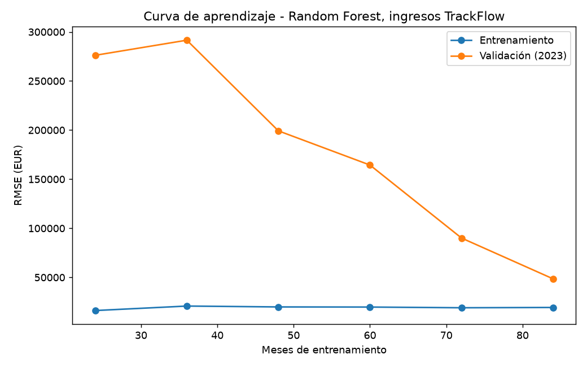

# Evaluación técnica del modelo de ventas de TrackFlow

Modelo: Random Forest (500 árboles, `min_samples_leaf=2`, `random_state=42`) sobre `revenue_eur` (`market = consolidated`).
Datos: solo el conjunto de entrenamiento 2016-2023 (96 meses). El test 2024-2025 no se ha usado en ninguna decisión.
Reproducible con `uv run python scripts/evaluate_regression_model.py`.

## Veredicto

**Overfitting moderado**, con un error absoluto bajo (≈4,3-4,6 % del ingreso mensual medio). El modelo es utilizable, pero su error de entrenamiento (≈2 %) es menor que el de validación y menor que el ruido irreducible estimado del dataset.

## Metodología

- **Validación cruzada temporal:** `TimeSeriesSplit(n_splits=5, test_size=12)`. Ventana expansiva: entrenamiento de 36, 48, 60, 72 y 84 meses y validación de los 12 meses siguientes (2019, 2020, 2021, 2022 y 2023). Un `assert` comprueba en cada ejecución que los índices son contiguos, que train y validación no se solapan, que todo índice de validación es posterior a los de entrenamiento y que los folds avanzan en el tiempo.
- **Sin fuga de features:** lags 1-3, medias/desviaciones rodantes y el lag de 12 meses se calculan dentro de cada fold solo con su parte de entrenamiento. En validación, el pronóstico es recursivo: las predicciones previas alimentan los lags, nunca los valores reales de la ventana.
- **Métricas:** MAE y RMSE en EUR. La columna "1 mes" es un pronóstico a un mes con lags reales, comparable con el error de entrenamiento (que usa lags reales). La columna "12 meses" es el pronóstico recursivo de las 12 mensualidades, el uso real del modelo.

## Resultados de la validación cruzada (media ± desviación estándar, 5 folds)

| Métrica | Entrenamiento | Validación, 1 mes | Validación, 12 meses recursivo |
|---|---|---|---|
| MAE (EUR) | 15 938 ± 1 016 | 36 973 ± 4 145 | 40 220 ± 6 043 |
| RMSE (EUR) | 19 770 ± 659 | 45 248 ± 3 440 | 48 665 ± 4 055 |
| RMSE / ingreso medio | ≈2,0 % | 4,3 % ± 0,6 | 4,6 % ± 0,7 |

| Fold | Meses train | Inicio validación | RMSE train | RMSE val 12m | MAE val 12m |
|---|---|---|---|---|---|
| 1 | 36 | 2019-01 | 20 787 | 54 479 | 44 545 |
| 2 | 48 | 2020-01 | 19 894 | 46 682 | 35 482 |
| 3 | 60 | 2021-01 | 19 766 | 43 569 | 32 310 |
| 4 | 72 | 2022-01 | 19 055 | 50 089 | 46 345 |
| 5 | 84 | 2023-01 | 19 348 | 48 508 | 42 415 |

El detalle completo está en [cv_metrics.csv](cv_metrics.csv) y [cv_summary.csv](cv_summary.csv).

## Curva de aprendizaje

Validación fija: los últimos 12 meses del train (2023). Entrenamiento: prefijos crecientes de 24 a 84 meses (datos en [learning_curve.csv](learning_curve.csv)).

| Meses train | RMSE train | RMSE validación |
|---|---|---|
| 24 | 16 219 | 276 177 |
| 36 | 20 787 | 291 563 |
| 48 | 19 894 | 199 220 |
| 60 | 19 766 | 164 405 |
| 72 | 19 055 | 90 052 |
| 84 | 19 348 | 48 508 |

**Interpretación:** la curva de entrenamiento es plana en ≈19-20 mil EUR y la de validación baja con fuerza al crecer el set, pero con 84 meses sigue sin tocar a la de entrenamiento (48,5 mil frente a 19,3 mil). Una brecha amplia y persistente entre un error de entrenamiento bajo y uno de validación alto es el patrón de **overfitting**. No es underfitting: el error de entrenamiento es bajo y las curvas no convergen en un error alto. Con 24-36 meses el modelo apenas ha visto 2-3 estaciones completas y su error es inservible.

## Respuestas al ticket

### 1. ¿Underfitting, overfitting o bien ajustado?

**Overfitting moderado.** Evidencia:
- El error de validación a 1 mes (RMSE 45 248) es 2,3 veces el de entrenamiento (19 770) en los cinco folds, también en el de 84 meses, sin el efecto de la recursión. La brecha no es un artefacto del pronóstico recursivo.
- El RMSE de entrenamiento (≈2 % del ingreso) queda por debajo del ruido irreducible estimado del dataset: el briefing describe una fluctuación mensual de ±5 % alrededor de la tendencia, es decir, una desviación típica de ≈2,9 % (≈30-35 mil EUR). Un modelo no puede explicar legítimamente ese ruido, así que parte del error de entrenamiento bajo es memorización. Esta cifra es una estimación a partir del briefing, no una medición.
- Matiz honesto: un Random Forest siempre mira sus propios datos de entrenamiento, así que parte de la brecha es inherente al algoritmo. Por eso la conclusión se apoya en la comparación con el ruido y en la curva, no solo en el cociente.
- Es "moderado" porque el error de validación (≈4,5 %) está cerca del ruido irreducible estimado: hay poco margen real de mejora.

### 2. ¿Qué tan estable es el desempeño según los datos de entrenamiento?

Razonablemente estable a partir de 36 meses: RMSE de validación 43,6-54,5 mil EUR entre folds (desviación estándar 4,1 mil, 8 % de la media) y 4,0-5,7 % del ingreso. El error en EUR no baja de forma monótona al añadir años, porque cada fold valida un año distinto y con un nivel de ingreso mayor, y el fold 4 (2022) es el más difícil después del primero. Por debajo de 36 meses el modelo no es fiable (curva de aprendizaje: 200-290 mil EUR de error).

### 3. Acción correctiva

**Regularizar con `min_samples_leaf=4` y `max_features=0.5`** (en `RandomForestRegressor`), no añadir complejidad. Comprobado con la misma CV, solo sobre train:

| Configuración | RMSE train | RMSE val 12m | RMSE val 1m |
|---|---|---|---|
| base (`leaf=2`, `max_features=1.0`) | 19 770 | 48 665 ± 4 055 | 45 248 |
| `leaf=4` | 27 397 | 49 405 ± 3 888 | 45 606 |
| `leaf=8` | 34 678 | 51 822 ± 3 524 | 47 544 |
| **`leaf=4`, `max_features=0.5`** | 29 014 | 49 585 ± 3 856 | 45 121 |

Por qué esta y no otra:
- Causa raíz: hojas de 2 muestras sobre solo 84 filas hacen que los árboles aíslen casi cada mes y memoricen su ruido (error de train 2 % por debajo del ruido real). Subir `min_samples_leaf` a 4 obliga a promediar al menos 4 meses por hoja, y `max_features=0.5` decorrelaciona los árboles, y el error de entrenamiento sube a ≈29 mil, en línea con el ruido real.
- El error de validación no empeora de forma apreciable (45 121 frente a 45 248 a 1 mes; las diferencias están dentro de 1 desviación estándar de ≈3,5-4 mil), así que la brecha se cierra sin perder precisión.
- `leaf=8` ya empeora la validación (51,8 mil): esa regularización es excesiva y empuja a underfitting, por lo que no se recomienda ir más allá.
- No se recomienda "más datos" como primera respuesta: con el ruido irreducible estimado, la validación ya está cerca de su suelo, y el beneficio de añadir 2024-2025 aparece al reentrenar para producción, no como corrección de este diagnóstico.

**Alcance:** la mejora de generalización es pequeña y no significativa estadísticamente con 5 folds; el beneficio de la acción es que el modelo deja de memorizar ruido y su error de entrenamiento pasa a ser una estimación honesta de su error real. No se ha cambiado `scripts/sales_forecast.py`; adoptarla requiere una decisión explícita.

## Métrica principal: RMSE

Del briefing se infiere, sin que lo diga de forma explícita, que Almacén y Carriers dimensionan capacidad según los picos de temporada (noviembre-diciembre) y los valles (febrero). Un error grande en un mes pico (infradimensionar o sobredimensionar capacidad) cuesta bastante más que varios errores pequeños. El **RMSE** penaliza cuadráticamente los errores grandes, así que refleja mejor ese coste. El **MAE** se mantiene como métrica secundaria porque es directamente interpretable en EUR y robusta a un mes atípico. El briefing no cuantifica la asimetría entre sobreestimar y subestimar; esta elección es una inferencia de negocio, no un dato.
